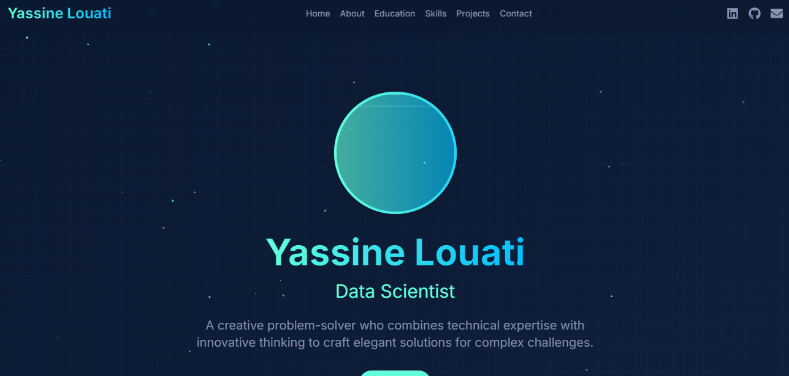
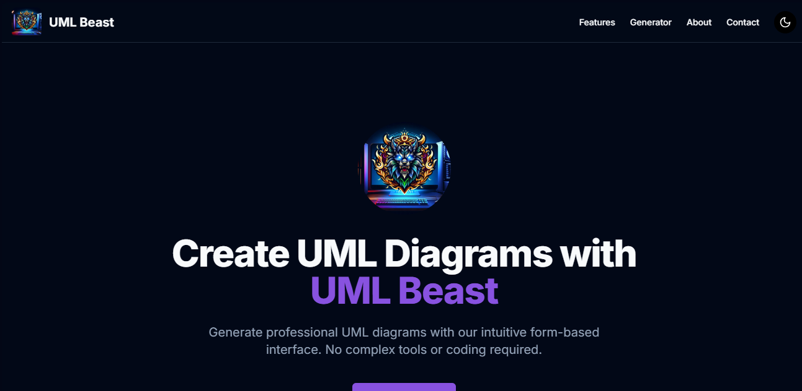
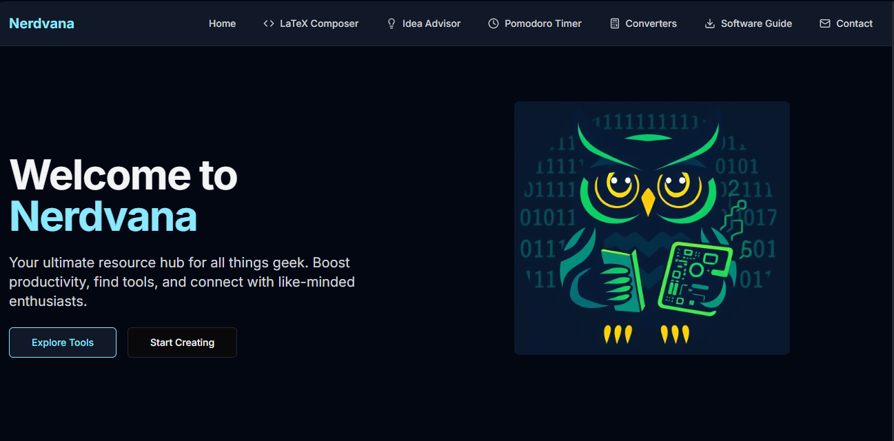
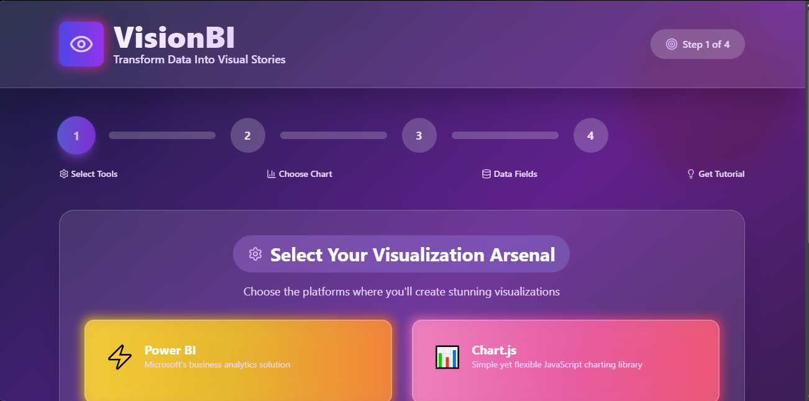
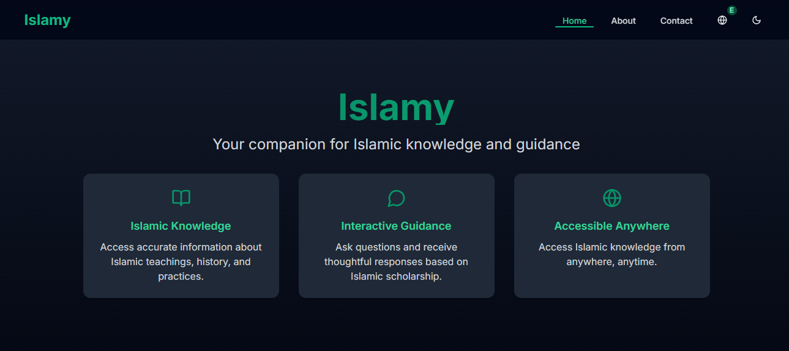
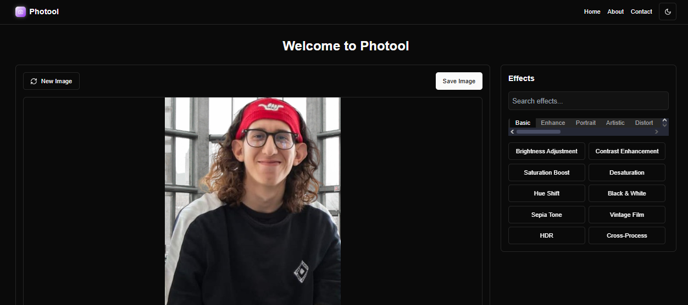
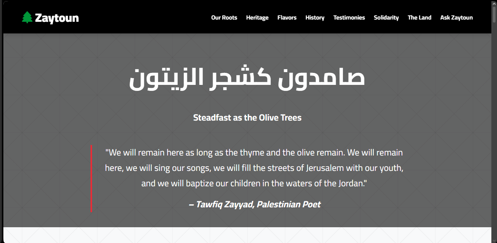
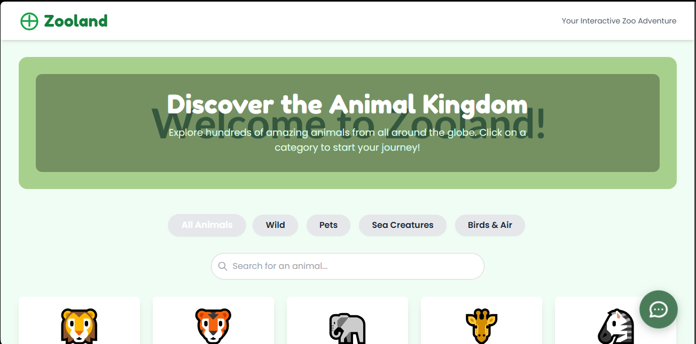
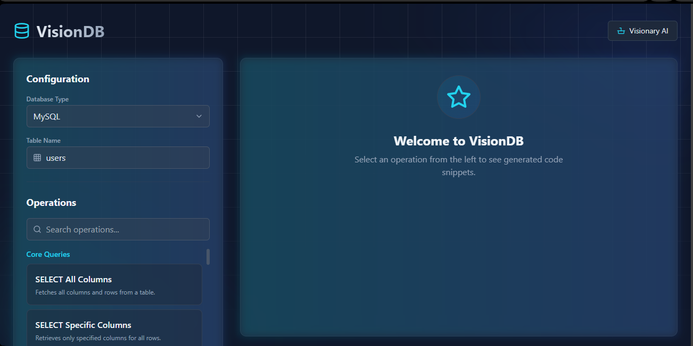
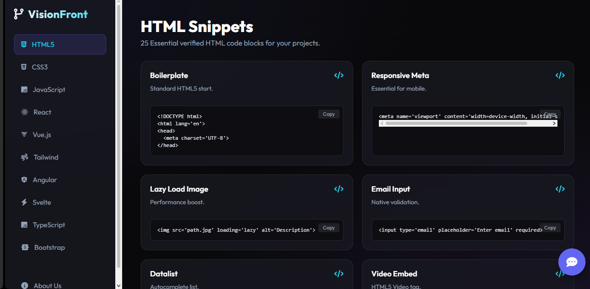

<!-- Banner Section -->

  
    

  <!-- Animated Typing Header -->
  
   

  <!-- Visitor Counter -->
  

 

## 🌌 About Me
Welcome to my GitHub profile! I am **Yassine Louati**, a future Data Science and AI Engineer. I love creating innovative projects and sharing my work with the world. Feel free to explore my repositories and connect with me through my socials below.

---

## 📊 GitHub Analytics

  <!-- Overall GitHub Stats -->
  

  <!-- GitHub Streak Stats -->
  
    

  <!-- Activity Graph -->
  

---

  <!-- Snake Animation -->
  <picture>
    <source media="(prefers-color-scheme: dark)" srcset="https://raw.githubusercontent.com/Yassino14/Yassino14/output/github-contribution-grid-snake-dark.svg">
    <source media="(prefers-color-scheme: light)" srcset="https://raw.githubusercontent.com/Yassino14/Yassino14/output/github-contribution-grid-snake.svg">
    
  </picture>

---

## 💻 Tech Stack

  

    
    
    
    
    
    
    
    
  

  

    
    
    
    
    
    
    
    
    
  

  

    
    
    
    
    
    
    
  

  

    
    
    
    
    
    
    
    
    
    
    
  

  

    
    
    
    
    
    
    
    
  

  

    
    
    
    
    
  

---

## 📜 Certifications
* 🏆 **SQL™ — Oracle Database SQL Certified Associate**
* 🏆 **PCAP™ — Certified Associate Python Programmer**
* 🏆 **PSM I — Professional Scrum Master I**
* 🏆 **Agile Project Management — HP LIFE**
* 🏆 **Introduction to Prompt Engineering with GitHub Copilot**
* 🏆 **Artificial Intelligence for Business**
* 🏆 **Gemini for Google Workspace**
* 🏆 **Online Freelancing Strategies and AI**

---

## 🌟 Featured Projects

<table>
  <tr>
    <td width="50%" align="center">
      <a href="https://github.com/Yassino14/portfolio">
        
         
        <strong>Personal Portfolio</strong>
      </a>
    </td>
    <td width="50%" align="center">
      <a href="https://github.com/Yassino14/umlbeast">
        
         
        <strong>UMLBeast</strong>
      </a>
    </td>
  </tr>
  <tr>
    <td width="50%" align="center">
      <a href="https://github.com/Yassino14/nerdvana">
        
         
        <strong>Nerdvana</strong>
      </a>
    </td>
    <td width="50%" align="center">
      <a href="https://github.com/Yassino14/visionbi">
        
         
        <strong>VisionBI</strong>
      </a>
    </td>
  </tr>
  <tr>
    <td width="50%" align="center">
      <a href="https://github.com/Yassino14/Islamy">
        
         
        <strong>Islamy</strong>
      </a>
    </td>
    <td width="50%" align="center">
      <a href="https://github.com/Yassino14/photool">
        
         
        <strong>Photool</strong>
      </a>
    </td>
  </tr>
  <tr>
    <td width="50%" align="center">
      <a href="https://github.com/Yassino14/zaytoun">
        
         
        <strong>Zaytoun</strong>
      </a>
    </td>
    <td width="50%" align="center">
      <a href="https://github.com/Yassino14/zooland">
        
         
        <strong>Zooland</strong>
      </a>
    </td>
  </tr>
  <tr>
    <td width="50%" align="center">
      <a href="https://github.com/Yassino14/VisionDB">
        
         
        <strong>VisionDB</strong>
      </a>
    </td>
    <td width="50%" align="center">
      <a href="https://github.com/Yassino14/VisionFront">
        
         
        <strong>VisionFront</strong>
      </a>
    </td>
  </tr>
</table>

---

## 🚀 Let's Connect

  📫 <strong>How to reach me:</strong> <a href="mailto:louati.yessine1@gmail.com">louati.yessine1@gmail.com</a>

 

<!-- Footer Wave -->

  

